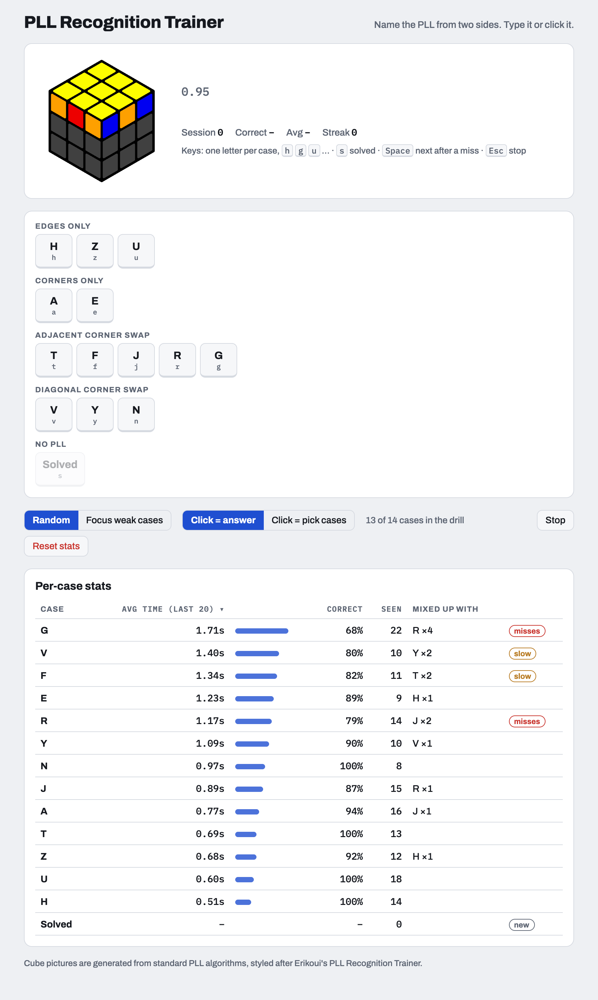

# PLL Recognition Trainer

Drill the recognition half of CFOP's last step. The trainer shows a cube from two sides, you name the PLL, and it tracks how fast and how accurately you recognize each case, then focuses on your weak spots.

**Live: https://kianoladive.github.io/pll-recognition/**



<sub>Screenshot uses made-up sample stats.</sub>

## Features

- **One keystroke per answer.** Type `h`, `g`, `u`… (or click). Letter families are pooled: **G** covers Ga–Gd, **J** covers Ja/Jb, and so on, because recognizing the family is the hard part.
- **16 pictures per PLL.** Every case appears from all 4 angles in all 4 color rotations of the scheme, so you learn the color *pattern* instead of memorizing a picture. ("F has a green bar" stops being a shortcut.)
- **Per-case stats.** Average recognition time over your last 20 correct answers, accuracy, and which case you mix it up with most. Slow or often-missed cases get flagged.
- **Focus weak cases.** A weighted picker that shows missed and slow cases more often, and brand-new cases until there's enough data.
- **Recognition guide.** A popover with [Mark49152's Two-Sided PLL Recognition Guide](https://cubing.pt/wp-content/uploads/2017/03/pll2side-20140531.pdf): 9 patterns (3-bar, lights, 2-bars, bookends, checkers), each rule shown as a sticker strip plus a real cube example. The guide's rules are also implemented in code (`src/guide.ts`) and tested against all 336 pictures, so every rule is checked to name the right PLL.
- **Set sessions.** Choose 10, 25, 50 or 100 cases (or endless). The session ends on its own with a summary of accuracy and average time.
- **Pick your cases.** Drill a subset, such as just the diagonal-swap cases.
- **Works offline, no account.** Stats stay in your browser's localStorage.

| Key | Action |
| --- | --- |
| `Space` / `Enter` | Start, or next case after a miss |
| letters | Answer |
| `Backspace` | Clear what you've typed |
| `Esc` | Stop |

## Run it locally

```bash
npm install
npm run dev
```

Then open http://localhost:5173.

| Script | What it does |
| --- | --- |
| `npm run dev` | Dev server with hot reload |
| `npm test` | Unit tests (Vitest) |
| `npm run build` | Type-check, then build the static site into `dist/` |
| `npm run preview` | Serve the built `dist/` locally |
| `npm run cubes` | Regenerate the 336 cube pictures in `public/cubes/` |
| `npm run screenshot` | Regenerate `docs/screenshot.png` (needs Chrome, Edge or Brave installed) |

## How the cube pictures are made

No image is drawn by hand. `src/cube.ts` is a small 3D sticker simulator: each PLL is defined by a standard algorithm, and running that algorithm backwards on a solved cube sets the case up. The script reads the 12 side stickers of the top layer, picks the two faces a given angle shows, rotates the colors, and `src/render.ts` draws the result as an isometric SVG.

```
21 PLLs  ×  4 color rotations  ×  4 angles  =  336 SVGs   (public/cubes/Ga-red-3.svg, …)
```

The generated files are committed, so the app serves them as plain static images.

The tests check the cube model itself:

- every algorithm disturbs only the top layer (a real PLL)
- no two PLLs ever look the same from two sides
- every one of the 84 PLL pictures in the original picture set appears among the generated pictures of the case it was labelled as (`src/fixtures/reference-views.json` holds their sticker colors)

## How it's built

Vanilla TypeScript and Vite, no framework. The logic is kept apart from the DOM so it can be tested on its own.

```
scripts/
  generate-cubes.ts   Writes public/cubes/*.svg
src/
  cube.ts      Sticker simulator, PLL algorithms, angle and color rotation
  render.ts    Draws one view as an SVG
  cases.ts     The 13 PLL families: variants, groups, keyboard aliases
  trainer.ts   The drill loop: start → show → answer → next. No DOM, injectable clock and RNG
  stats.ts     Recording answers, weak-case weighting, building and sorting the stats table
  input.ts     Turns keystrokes into answers (prefix matching over aliases)
  storage.ts   localStorage wrapper that never throws (private windows, blocked storage)
  ui.ts        Rendering
  main.ts      Wires the trainer, input and UI together
```

A few details worth knowing:

- **Recognition time starts when the picture has rendered**, not when it was requested, so image load time never counts against you.
- **Weak mode weighting:** each case gets `1 + 6 × error rate + 3 × max(0, its avg / overall avg − 0.7)`. Cases with fewer than 3 attempts get a flat weight of 3.
- **The same case never appears twice in a row** (unless it's the only one selected).

## Credits

The picture style and colors follow Erikoui's PLL Recognition Trainer, whose pictures were used to verify the generated ones. The recognition guide is [Mark49152's Two-Sided PLL Recognition Guide](https://cubing.pt/wp-content/uploads/2017/03/pll2side-20140531.pdf) (v2014.05.31). The idea comes from the [CubeSkills PLL Recognition Trainer](https://www.cubeskills.com/tools/pll-recognition-trainer).
